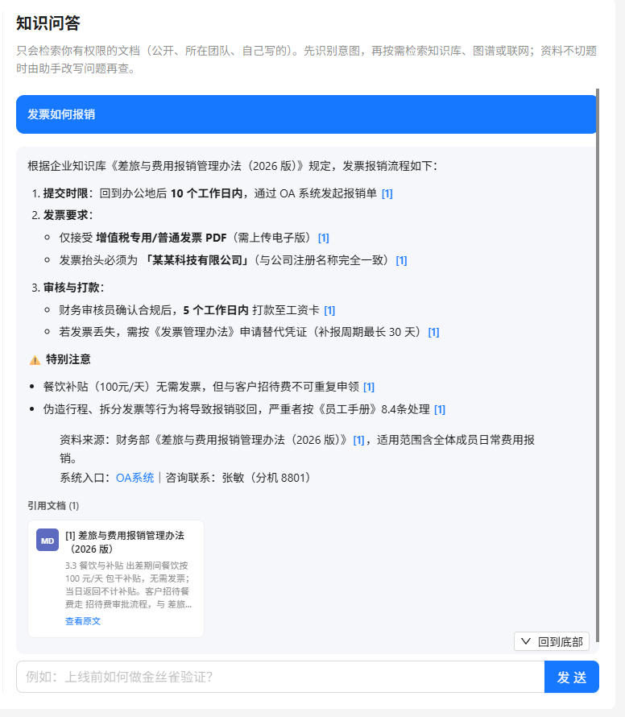
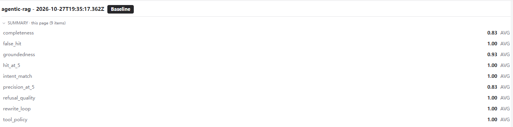

# Knowledge Hub · 企业知识库 AI 问答

基于 NestJS + LangGraph 的企业知识库问答系统。文档上传后自动解析、切片、向量化并建立索引，问答时由 Agent 自主编排「混合检索 / 知识图谱 / 联网搜索」三类工具，答案带原文引用，可逐条核对。

> 个人工程实践项目，用于学习 Agentic RAG 的完整落地链路。前端不在本仓库内。

**核心链路**

```
文档上传 → 解析 → 切片 → 向量化 → ES 索引 + Neo4j 图谱
用户提问 → 意图识别 → 工具编排（检索 / 图谱 / 联网）→ 评估 → 改写 → 生成（带引用）
```

---

## 截图

| 知识库问答（带原文引用） | 离线评测（Langfuse Experiment） |
| --- | --- |
|  |  |

## 功能

### 文档入库
- 支持 PDF / DOCX / PPTX / XLSX / 纯文本；复杂版式（表格、公式、扫描件）走 **MinerU** 解析为 Markdown
- 切片（512 tokens，overlap 64）→ 批量向量化（1024 维）→ 写入 Elasticsearch 与 Neo4j
- 全异步流水线，由 **RabbitMQ** 驱动，文档状态机：`上传 → 解析 → 审核 → 发布 → 索引完成`
- 草稿不可检索，**审核通过**后才进入知识库

### 混合检索
- ES `dense_vector` kNN + BM25 关键词双路召回，各取 Top20
- **RRF（k=60）** 融合 → `qwen3-rerank` 精排 → 0.4 分阈值截断
- 结果按用户 / 团队做**文档级 ACL 过滤**

### Agentic RAG
- Agent 先判定意图：`知识库 / 联网搜索 / 闲聊 / 个人偏好`，再决定调哪些工具
- 检索后进入**评估节点**判断是否切题；不切题则改写 query 重试（最多两轮）
- 两轮仍无结果 → **明确拒答**，不编造制度条款
- 闲聊与个人偏好不触发检索；知识库不足时可降级到联网搜索

### 记忆
- **短期记忆**：维护会话上下文并做指代消解（「那这个找谁」能钉住上一轮话题）
- **长期记忆**：Mem0 按 `user / session` 分层，跨会话延续用户偏好，且不把文档里的人名写进用户画像

### 可观测与评测
- Langfuse 记录每轮对话的意图、工具调用、检索命中、耗时
- 自建金标评测集（9 条，覆盖 `routing / kb-hit / rewrite / kb-empty / web` 5 类场景）+ LLM Judge 打分
- 指标：意图准确率、工具策略合规、召回命中率 / 精度、拒答正确性、答案忠实度

---

## 架构

```
                          ┌──────────────────────────────────────┐
   上传文档 ──▶ Document ──▶│ RabbitMQ → Pipeline                  │
                 Service   │  parse → chunk → embed → index       │
                          └───────┬───────────────┬──────────────┘
                                  ▼               ▼
                          Elasticsearch        Neo4j
                          (kh_chunk)         (实体 / 关系)
                                  ▲               ▲
                                  │               │
   用户提问 ──▶ AI Service ──▶ 意图识别 ──┬──▶ 混合检索 ──┐
                (LangGraph)              ├──▶ 图谱查询 ──┤
                                         └──▶ 联网搜索 ──┤
                                                        ▼
                                              评估是否切题 ──否──▶ 改写 query（≤2 轮）
                                                        │是
                                                        ▼
                                             生成答案（带 [n] 引用）
```

后端模块（NestJS）：

| 模块 | 职责 |
| --- | --- |
| `document/` | 文档 CRUD、上传解析、审核发布、状态机 |
| `pipeline/` | 切片、向量化、ES 索引、图谱构建 |
| `mq/` | RabbitMQ 生产者 / 消费者，驱动异步流水线 |
| `ai/` | Agent 编排、混合检索、rerank、记忆、评测 |
| `graph/` | 知识图谱查询接口 |
| `auth/` `user/` `team/` | JWT 鉴权、RBAC 权限、团队与文档 ACL |

---

## 技术栈

| 层 | 选型 |
| --- | --- |
| 框架 | NestJS 12 / TypeScript / Express |
| Agent | LangGraph、LangChain、Vercel AI SDK |
| 模型 | qwen-plus（对话）、text-embedding-v3（1024 维）、qwen3-rerank（精排） |
| 检索 | Elasticsearch 8（dense_vector kNN + BM25） |
| 图谱 | Neo4j |
| 存储 | PostgreSQL（业务）、MongoDB（文档内容）、RustFS（S3 兼容对象存储） |
| 中间件 | RabbitMQ、Redis |
| 记忆 | Mem0 |
| 可观测 | Langfuse（Tracing / Dataset / Experiment）、OpenTelemetry |
| 部署 | Docker Compose |

---

## 快速开始

**前置**：Node.js ≥ 20、pnpm、Docker

```bash
# 1. 安装依赖
pnpm install

# 2. 配置环境变量（参照下方「环境变量」自行创建 .env）
cp .env.example .env   # 若无 .env.example，按表格填写

# 3. 启动依赖中间件
docker compose up -d

# 4. 启动服务（默认 3000 端口）
pnpm start:dev
```

启动后访问 `http://localhost:3000`。附带管理界面：Kibana（ES）、pgAdmin、mongo-express、RedisInsight，Neo4j Browser 见 compose 端口映射。

### 环境变量

| 变量 | 说明 |
| --- | --- |
| `PORT` | 服务端口，默认 3000 |
| `POSTGRES_*` / `MONGO_URI` | 业务库与文档库连接 |
| `REDIS_*` | 会话缓存、短期记忆 |
| `ELASTICSEARCH_NODE` | ES 地址，需开启 `ELASTICSEARCH_ENABLED` |
| `NEO4J_URI` / `NEO4J_USER` / `NEO4J_PASSWORD` | 图谱连接 |
| `RABBITMQ_URL` | MQ 连接，需开启 `RABBITMQ_ENABLED` |
| `RUSTFS_*` | S3 兼容对象存储（上传原文件） |
| `OPENAI_API_KEY` / `OPENAI_BASE_URL` / `MODEL_NAME` | 对话模型（OpenAI 兼容协议） |
| `EMBEDDING_*` | 向量模型地址、维度、批大小 |
| `RAG_CHUNK_SIZE` / `RAG_CHUNK_OVERLAP` | 切片参数 |
| `RAG_HYBRID_TOP_K` / `RAG_RRF_C` / `RAG_MIN_SCORE` | 召回路数、RRF 常数、精排阈值 |
| `RAG_RERANK_MODEL` | 精排模型 |
| `BOCHA_API_KEY` | 联网搜索 |
| `MEM0_API_KEY` / `MEM0_HOST` | 长期记忆 |
| `LANGFUSE_*` / `LANGSMITH_*` | 可观测与评测 |
| `MINERU_API_TOKEN` | 复杂文档解析 |
| `JWT_SECRET` | 鉴权签名 |
| `DOCUMENT_REQUIRE_APPROVAL` | 是否草稿需审核后才可检索 |

---

## 评测

金标集在 `src/ai/eval/golden-dataset.ts`，评测器在 `evaluators.ts`，通过 Langfuse Experiment 跑：

```bash
# 全量
npx ts-node -r tsconfig-paths/register src/ai/eval/run-experiment.ts

# 只跑某一类场景
EVAL_FILTER=kb-hit npx ts-node -r tsconfig-paths/register src/ai/eval/run-experiment.ts
```

配置了 `LANGFUSE_*` 时结果写入 Experiment 面板，否则只在终端打印。

| 场景 | 覆盖内容 |
| --- | --- |
| `routing` | 闲聊、个人偏好不应触发检索 |
| `kb-hit` | 应命中指定文档并答对关键信息 |
| `rewrite` | 词面沾边但实质不相关，应触发改写 |
| `kb-empty` | 库里没有，必须拒答而非编造 |
| `web` | 外部时效性问题应走联网 |

---

## 目录结构

```
src/
├── ai/                  # Agent 编排、检索、记忆、评测
│   ├── ai-stream.service.ts      # 主流程：意图 → 工具 → 评估 → 生成
│   ├── agentic-retrieve.ts       # Agentic 检索工具集
│   ├── hybrid-retrieval.service.ts
│   ├── reranker.service.ts
│   ├── chat-*-memory.service.ts  # 短期 / 长期记忆
│   └── eval/                     # 金标集、评测器、实验入口
├── document/            # 文档 CRUD、解析、审核发布
├── pipeline/            # 切片、向量化、ES 索引、图谱构建
├── mq/                  # RabbitMQ 异步流水线
├── graph/               # 图谱查询接口
├── auth/ user/ team/    # 鉴权与权限
└── observability/       # Langfuse Tracing
```

---

## 设计取舍

**为什么用 RRF 而不是加权求和**
向量分与 BM25 分不在同一量纲，直接加权需要反复调权重且对语料敏感。RRF 只用排名，天然免归一化，不同文档类型下更稳。

**为什么把「评估」拆成独立节点**
如果让生成模型自己判断"检索结果够不够"，它会倾向于硬答。独立节点只输出「切题 / 不切题」这一比特，再驱动改写或拒答，比让模型自由发挥更可控。

**为什么允许拒答**
企业知识库最怕的是一本正经地编制度。宁可按"库中未收录"回退，也不让模型拿训练记忆糊弄，这条底线写进了评测集（`kb-empty`）。

**为什么保留关键词召回**
制度文档里大量专有名词、部门名、金额阈值、文号，纯向量检索容易召回"语义相近但不对"的段落，BM25 在这类精确匹配上仍不可替代。

---

## License

MIT
